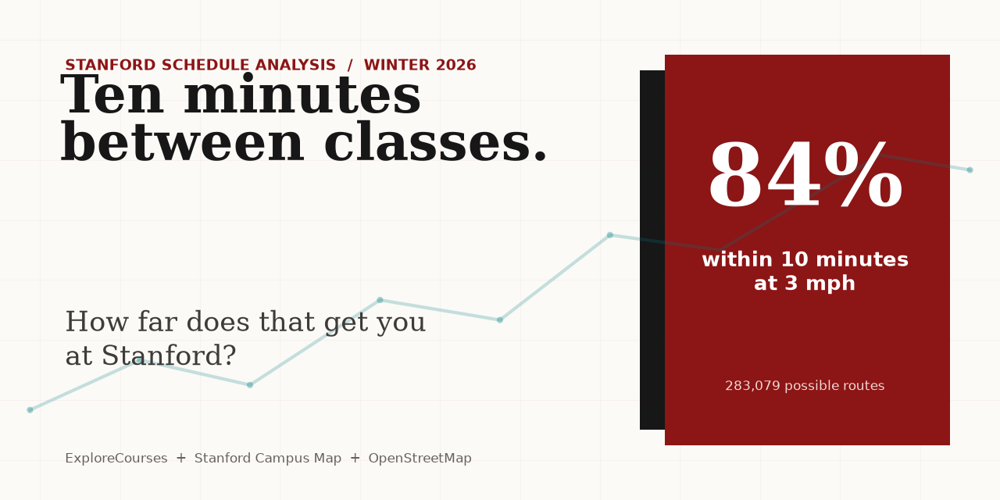
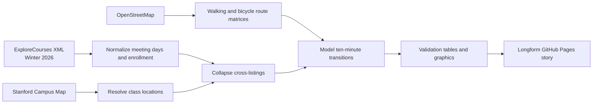

<p align="center">
  
</p>

<h1 align="center">The Ten-Minute Stanford</h1>

<p align="center">
  A reproducible data-journalism investigation of whether Stanford's published class schedule fits Stanford's physical campus.
</p>

<p align="center">
  
  
  
  
</p>

## The question

Stanford schedules many consecutive classes with a ten-minute gap. This project asks a narrower question than "Are students late?": **which possible class-location-to-class-location transitions fit inside those ten minutes under clearly stated walking assumptions?**

Winter 2026 meeting times and section enrollment from the public [ExploreCourses](https://explorecourses.stanford.edu/) XML view are matched to [Stanford Campus Map](https://campus-map.stanford.edu/) facilities and routed over separate [OpenStreetMap](https://www.openstreetmap.org/copyright) walking and directional bicycle networks. XML requests and fields follow the mentor-recommended, third-party [Explore Courses Python API](https://github.com/jeremyephron/explore-courses-api); the project retrieves and parses Stanford's responses directly.

|          At 3 mph           | With a 2-minute building allowance | 90th-percentile route |
| :-------------------------: | :--------------------------------: | :-------------------: |
| **84.4%** within 10 minutes |    **70.6%** within 10 minutes     |   **11.6 minutes**    |

These are project-derived estimates across **283,079 potential ordered meeting pairs**, not official Stanford statistics or observed student trips. ExploreCourses reports section size but not co-enrollment, so class sizes cannot identify actual student transitions.

A separate 27-response convenience survey adds student observations about
routes and travel conditions. Fourteen respondents reported being late and six
reported a close call; among 23 expanded responses, 11 described a consequence
beyond arrival time. These responses illustrate experiences; they do not
estimate prevalence among Stanford students.

The reporting layer also compares **2,035 lecture and 911 discussion
meeting-day rows** and directly tests **62,525 possible LEC/DIS transitions**.
It maps where the largest subject areas hold coursework, reports incoming and
outgoing route feasibility for 161 subject areas, and screens **187 possible
different-building combinations** in which both meetings report at least 100
enrolled. Fifteen of those large-meeting combinations exceed ten modeled
minutes at 3 mph; none of these comparisons is a co-enrollment estimate.

The same Winter 2026 pair set is also tested as a policy counterfactual. At 3
mph, a 15-minute allowance raises the modeled fit share from **84.4% to 97.5%**;
with two minutes reserved for buildings, it changes from **70.6% to 94.3%**.
Fifteen minutes is historically grounded in the AY 2021-22 meeting pattern
reported by [The Stanford Daily](https://stanforddaily.com/2021/09/14/overlapping-class-meeting-times-leave-students-stressed/)
and shown in its linked [schedule spreadsheet](https://docs.google.com/spreadsheets/d/1Gxv03c2yyypmCF1Hot5VJ9f3Wi5LADMyjLsmiABhNsQ/edit?gid=1166637319#gid=1166637319),
but it is not presented as current Stanford policy.

Only official `stanford.edu` sources support claims about Stanford policy or
official systems. OpenStreetMap is an external analysis input, the GitHub API
package is an implementation reference, and the Daily links and historical
Google Sheet are editorial context only. The generated claim ledger records
this classification per source.

## Publication

The repository includes a responsive longform article, student survey reporting, an immediate walking/bicycle route checker, analysis of 25 actual passing-period slots, lecture/discussion timing, subject-area geography, a large-enrollment screen, a policy simulator, publication graphics, a full methodology, a source log and machine-readable audit files. GitHub Actions builds the public site as a minimal artifact and deploys it to GitHub Pages.

- [Article source](article/article.md)
- [Methodology](article/methodology.md)
- [Source log](article/source_log.md)
- [Claim ledger](reports/generated/claim_audit.json)

## Analysis pipeline



The unit of analysis is a potential ordered pair of unique physical room-time meetings on the same weekday with exactly ten minutes between published times. Cross-listed records sharing a room, date range and time are counted once. Repeated date blocks for the same ordered class-number pair, facility pair, weekday and time also count once.

## Reproduce locally

Python 3.11 or 3.12 is required.

```bash
python3.12 -m venv .venv
source .venv/bin/activate
python -m pip install -e ".[dev]"
make test
make audit-ci
make site
python -m http.server 8000 --directory _site
```

Open `http://127.0.0.1:8000/`. The Pages build fails if a local link or publication asset is missing.

To refresh the public-source snapshot and rerun the complete analysis:

```bash
make all
make social
make audit
make site
```

The default `make all` command preserves the article's Winter-only scope. A
separate `make year-analysis` target collects Autumn, Winter and Spring; run it
on a separate branch because it changes every generated statistic and graphic.

Collection is cached and rate-limited. Raw responses are intentionally excluded from Git because they total roughly 350 MB; the active 1,278-source manifest publishes the URL, retrieval time and SHA-256 for every response. The requests can be repeated, but a new collection cannot recover either historical snapshot if a source changes. Processed audit tables and final outputs remain in the repository. See [the data documentation](data/README.md).

## Repository map

```text
.
├── article/       # newsroom draft, methodology and source log
├── data/          # processed analysis inputs; raw snapshots are ignored
├── reporting/     # interviews, outreach and fact-check plans
├── reports/       # generated findings, tables, figures and validation
├── scripts/       # Pages builder and social-preview generator
├── site/          # static publication source
├── src/           # collection, matching, routing and analysis package
├── tests/         # parser, routing, analysis and production-site tests
└── .github/       # CI and GitHub Pages deployment
```

## Verification

The test suite covers mobile and XML ExploreCourses parsing, source discrepancies, Stanford Login rejection, room matching, walking and directional bicycle routing, cross-listing deduplication, Pages assembly and local links. The publication-consistency audit separately rebuilds the denominator and every headline statistic from processed rows, validates the route matrices and checks the active raw-source manifest. It is an internal audit, not an external replication.

```bash
pytest
ruff check .
python scripts/audit_publication.py
```

## Attribution and license

Schedule data: Stanford ExploreCourses. Facility coordinates: Stanford Campus Map. Walking and bicycle networks and map geometry: OpenStreetMap contributors. Analysis and graphics: Imran Zakirov and Alisher Sabitov.

The code is available under the [MIT License](LICENSE). OpenStreetMap-derived data remains subject to the [Open Database License](https://www.openstreetmap.org/copyright). Source-site terms and attribution requirements continue to apply to their data.
