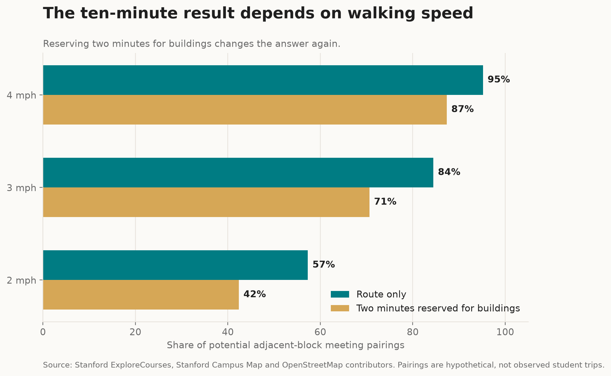
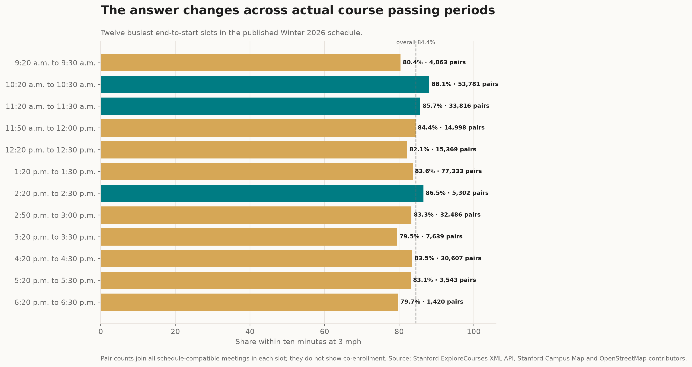
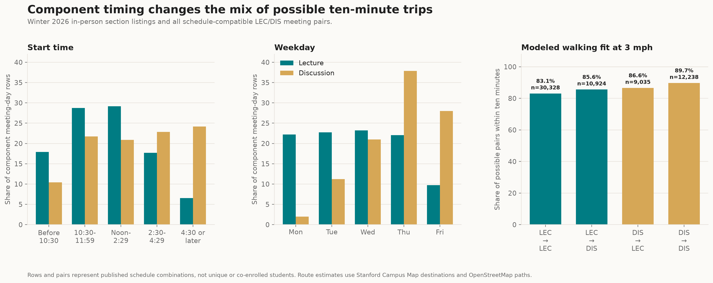
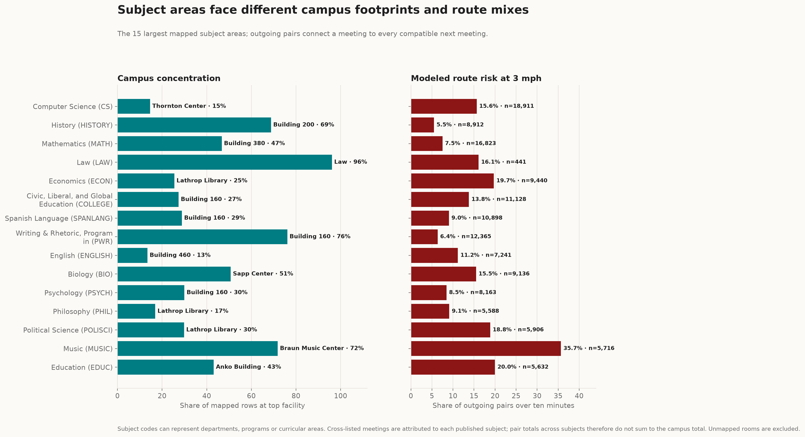
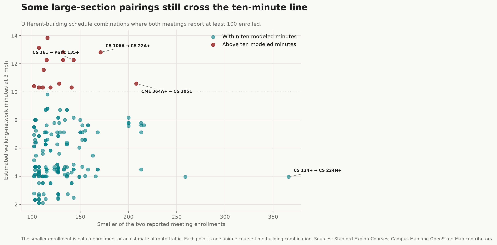
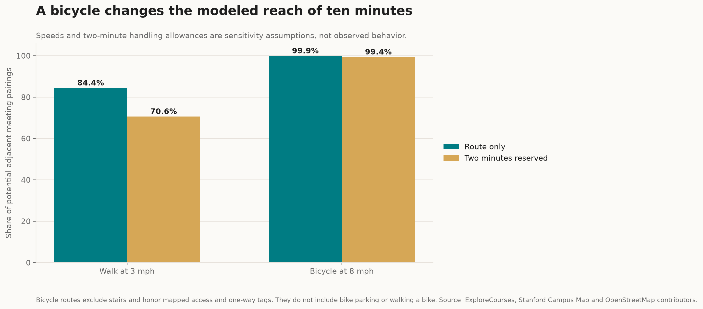
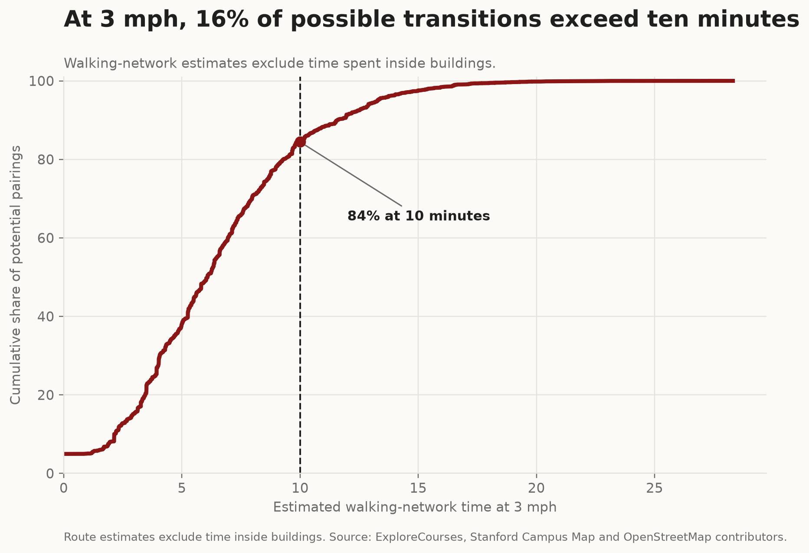
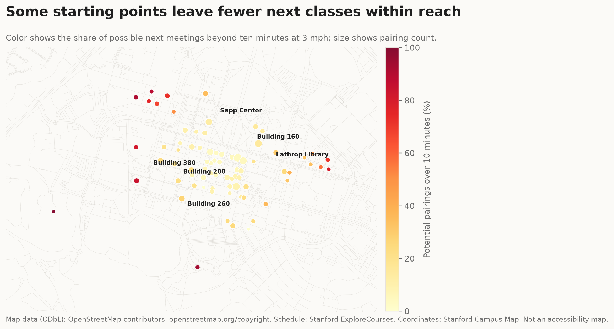

TITLE: The ten-minute test
SLUG: TEN-MINUTE TEST
AUTHORS: Imran Zakirov and Alisher Sabitov
SECTION: Data
STATUS: Draft for editor review

CONTENT

Most modeled walks fit. The routes that do not show how quickly Stanford's ten-minute passing period can disappear.

Stanford's [Unit of Credit guidance](https://bulletin.stanford.edu/pages/oCRJSOUvJspMtKMq0G4L) assumes that a class ends ten minutes early to allow students to move to the next class. Every back-to-back class gets the same passing period on paper. Campus geography decides how much of it survives on the ground.

We compared [ExploreCourses](https://explorecourses.stanford.edu/) XML class times in the Winter 2026 quarter with [Stanford Campus Map](https://campus-map.stanford.edu/) coordinates and used [OpenStreetMap](https://www.openstreetmap.org/copyright) data to calculate shortest walking-network routes. We then tested every possible pair of meetings on the same weekday when one meeting begins exactly 10 minutes after the other ends.

The typical modeled route clears the test. At 3 mph, [84.4%](https://imranqsl212.github.io/ten-minute-stanford/data/speed_summary.csv) of those possible transitions had an estimated route time of 10 minutes or less, and the median was 6.1 minutes. At the 90th percentile, however, [the route took 11.6 minutes, already beyond the next class's start time.](https://imranqsl212.github.io/ten-minute-stanford/data/speed_summary.csv)

That 15.6% is not a student lateness rate. The XML snapshot contained [27,197 Winter section records](https://imranqsl212.github.io/ten-minute-stanford/data/claim_audit.json) and [reported enrollment and capacity for every section,](https://imranqsl212.github.io/ten-minute-stanford/data/claim_audit.json) but it does not indicate which classes students take together. The result describes potential combinations of meetings in the schedule, not the trips students make.

LABEL: Bottom line

## What the numbers actually say

CALLOUT: Typical is not universal. [84%](https://imranqsl212.github.io/ten-minute-stanford/data/speed_summary.csv) of possible routes fit at 3 mph; the median is [6.1 minutes](https://imranqsl212.github.io/ten-minute-stanford/data/speed_summary.csv), while the 90th percentile is [11.6 minutes.](https://imranqsl212.github.io/ten-minute-stanford/data/speed_summary.csv)

CALLOUT: Buildings consume the margin. Reserve two minutes to exit and enter, and the fit rate falls from 84.4% to 70.6%.

CALLOUT: This tests a schedule, not students. Room matching covered [97.0%](https://imranqsl212.github.io/ten-minute-stanford/data/claim_audit.json) of eligible listing rows; without co-enrollment data, the pairs are possibilities, not observed trips or late arrivals.

## Ten minutes is not ten minutes of walking

The headline moves with the walking-speed assumption. At 2 mph, [57.3%](https://imranqsl212.github.io/ten-minute-stanford/data/speed_summary.csv) of possible transitions had an estimated route time of 10 minutes or less. At 4 mph, the share increased to [95.2%.](https://imranqsl212.github.io/ten-minute-stanford/data/speed_summary.csv)

These are sensitivity tests, not descriptions of slow, typical or fast walkers. The model is not meant to be an actual representation of the mobility of any person.

More important, the clock starts before a student is outside. In a scenario that reserves two minutes for leaving and entering buildings, the share drops to [70.6%](https://imranqsl212.github.io/ten-minute-stanford/data/speed_summary.csv) at 3 mph because only eight minutes remain for the modeled route.

CAPTION: Time available changes the conclusion. Speeds and the two-minute building allowance are scenarios, not measured student groups. [Inspect the scenario table.](https://imranqsl212.github.io/ten-minute-stanford/data/speed_summary.csv) Sources: Stanford ExploreCourses, Stanford Campus Map and [OpenStreetMap contributors](https://www.openstreetmap.org/copyright).

## The schedule has rush hours

The busiest passing period had the most possible routes, not the best fit. The published schedule contains [25 distinct ten-minute end-to-start time slots,](https://imranqsl212.github.io/ten-minute-stanford/data/time_slot_summary.csv) or [92 combinations when weekdays are counted separately.](https://imranqsl212.github.io/ten-minute-stanford/data/weekday_time_slot_summary.csv) [At 1:20 p.m. to 1:30 p.m., there were 77,333 possible pairs and 83.6% fit at 3 mph. The 10:20 a.m. to 10:30 a.m. slot had 53,781 possible pairs and a higher modeled fit rate of 88.1%.](https://imranqsl212.github.io/ten-minute-stanford/data/time_slot_summary.csv)

These totals still count possible meeting combinations, not students. Reported enrollment can show how many section seats are scheduled around a time slot, but it cannot show how many students need a particular building-to-building route.

CAPTION: Course times create different route mixes. The bars use actual published end and start times. Pair counts are schedule combinations, not co-enrolled students. [Inspect the slot table.](https://imranqsl212.github.io/ten-minute-stanford/data/time_slot_summary.csv)

## Lectures and discussions run on different clocks

Lectures and discussions occupy different parts of the timetable. [Stanford defines LEC as a lecture course and DIS as the discussion-section component of a lecture course.](https://advising.stanford.edu/current-students/advising-student-handbook/course-catalog) In the Winter snapshot, the median published start was noon across [2,035 eligible LEC meeting-day rows](https://imranqsl212.github.io/ten-minute-stanford/data/component_time_summary.csv) and 1:30 p.m. across [911 DIS rows.](https://imranqsl212.github.io/ten-minute-stanford/data/component_time_summary.csv)

Discussion rows also tilted later in the day and week: [47.0% began at 2:30 p.m. or later, compared with 24.2% of lecture rows;](https://imranqsl212.github.io/ten-minute-stanford/data/component_time_summary.csv) [65.9% fell on Thursday or Friday, compared with 31.8% of lecture rows.](https://imranqsl212.github.io/ten-minute-stanford/data/component_day_summary.csv) These are section-listing meeting-day rows, so a class scheduled on two weekdays contributes two rows. They describe the published timetable, not attendance or unique students.

The route mix shifts with that timetable. Among [62,525 possible pairs in which both meetings were coded LEC or DIS, 83.1% of LEC-to-LEC pairs fit within ten modeled minutes at 3 mph.](https://imranqsl212.github.io/ten-minute-stanford/data/component_transition_summary.csv) The corresponding shares were 85.6% for LEC-to-DIS, 86.6% for DIS-to-LEC and 89.7% for DIS-to-DIS pairs. These percentages compare schedule-compatible meetings, not the schedules of students who move between lectures and sections.

CAPTION: Component timing changes the route mix. The third panel connects the schedule pattern to walking feasibility for 62,525 possible LEC/DIS meeting pairs. Inspect the [time table](https://imranqsl212.github.io/ten-minute-stanford/data/component_time_summary.csv) and [weekday table](https://imranqsl212.github.io/ten-minute-stanford/data/component_day_summary.csv), then the [transition table](https://imranqsl212.github.io/ten-minute-stanford/data/component_transition_summary.csv). Sources: Stanford ExploreCourses, Stanford Campus Map and OpenStreetMap contributors.

## Subject areas have different campus footprints

The map raises two different questions: where a subject teaches, and where a compatible next class might be. The ExploreCourses index listed [253 subject codes.](https://imranqsl212.github.io/ten-minute-stanford/data/department_location_summary.csv) [Stanford's SIRIS documentation says that a subject usually represents a domain of study but can also identify a curricular category,](https://siris.stanford.edu/sites/g/files/sbiybj16456/files/media/file/common-terms-in-siris-student-analytics.pdf) so this analysis calls them subject areas rather than assuming that every code is a formal department.

Among the 15 subject areas with the most mapped meeting-day rows, [Law placed 96.1% of its rows at the facility labeled Law and History placed 68.8% at Building 200.](https://imranqsl212.github.io/ten-minute-stanford/data/department_location_summary.csv) Computer Science was more dispersed: Thornton Center, its most-used mapped facility, accounted for 14.6%. English's top facility, Building 460, accounted for 13.4%. Cross-listed listings remain under each published subject code, and the 178 eligible rows with unresolved room labels are absent from this comparison.

Concentration does not guarantee a short next trip. Among the same 15 subject areas, [5.5% of possible outgoing pairs from History meetings exceeded ten modeled minutes at 3 mph, compared with 15.6% from Computer Science and 35.7% from Music.](https://imranqsl212.github.io/ten-minute-stanford/data/subject_transition_feasibility.csv) Campus concentration and outgoing route risk are different measures: the next compatible meeting may be outside the area where a subject holds most of its own classes.

CAPTION: Footprint and route risk are not the same measure. The left panel identifies each subject area's most-used mapped facility; the right tests possible routes from those meetings. [Inspect every subject-facility row](https://imranqsl212.github.io/ten-minute-stanford/data/department_location_summary.csv), then the [incoming and outgoing transition table.](https://imranqsl212.github.io/ten-minute-stanford/data/subject_transition_feasibility.csv) Sources: Stanford ExploreCourses, Stanford Campus Map and OpenStreetMap contributors.

## Large classes are not always close together

Size is no guarantee of a short handoff. For a transparent large-class screen, we grouped identical course-time-building combinations across weekdays and kept different-building combinations in which both meetings reported at least 100 enrolled. [Stanford Student Services says cross-listed classes are typically combined at the same time and place;](https://studentservices.stanford.edu/my-academics/enroll-classes/enrollment-troubleshooting) in this screen, records sharing one physical meeting were combined. This produced [187 possible combinations; 15, or 8.0%, exceeded ten modeled minutes at 3 mph.](https://imranqsl212.github.io/ten-minute-stanford/data/high_enrollment_transitions.csv)

The largest combination by the smaller enrollment fit comfortably: a 366-enrollment CS 124 / LINGUIST 180 / LINGUIST 280 meeting in Hewlett Teaching Center to a 546-enrollment CS 224N / LINGUIST 284 / SYMSYS 195N meeting in Huang Engineering Center, with a modeled route of 4.0 minutes.

Two other large combinations missed the ten-minute mark. CME 364A / EE 364A in Lathrop Library to CS 205L in Huang took 10.6 minutes. CS 106A in Hewlett to CS 22A / INTLPOL 200 / SYMSYS 122 in Zambrano Hall took 12.8 minutes.

The smaller enrollment is only a screen showing that both meetings are large. It is not a co-enrollment count, and the 187 combinations do not show that any student took both courses.

CAPTION: Large does not always mean close. Each point is one unique possible course-time-building combination; red points exceed ten minutes at 3 mph. The horizontal position uses the smaller of two reported enrollments, not enrollment overlap. [Inspect all 187 pairs.](https://imranqsl212.github.io/ten-minute-stanford/data/high_enrollment_transitions.csv) Source: Stanford ExploreCourses.

LABEL: Four published pairs

## Four routes, one ten-minute gap

Aggregate percentages hide the difference between a comfortable walk and an impossible one. The examples below use published Winter 2026 meetings on the same weekday whose active dates overlap. In each case, the first meeting ends exactly ten minutes before the second begins. A student enrolled in both sections would need to make the building-to-building transition, but ExploreCourses does not show whether any student actually took both.

### Near the median

Fits in the model

Ends Fri. at 9:20 a.m.

CHINLANG 22

Building 260

10 min

Begins Fri. at 9:30 a.m.

MATH 21

McCullough

490 m modeled route

6.1 min walk at 3 mph

+3.9 min modeled margin

4.8 min bike at 8 mph

### Near the limit

Only 0.5 min spare

Ends Fri. at 11:20 a.m.

STRAMGT 354

GSB Gunn

10 min

Begins Fri. at 11:30 a.m.

MATH 131P

Building 420

765 m modeled route

9.5 min walk at 3 mph

+0.5 min modeled margin

3.9 min bike at 8 mph

### Above the limit

2.0 min over

Ends Mon. at 9:50 a.m.

COMPLIT 248B

Building 70

10 min

Begins Mon. at 10:00 a.m.

OB 331

Zambrano Hall

966 m modeled route

12.0 min walk at 3 mph

-2.0 min modeled margin

6.9 min bike at 8 mph

### Longest modeled example

18.3 min over

Ends Wed. at 12:20 p.m.

HORSE 10

Red Barn Stables

10 min

Begins Wed. at 12:30 p.m.

BIO 71 / ESS 71

Encina West

2,278 m modeled route

28.3 min walk at 3 mph

-18.3 min modeled margin

10.8 min bike at 8 mph

Examples were selected by a fixed rule near the overall median, near 9.5 minutes, near 12 minutes and at the longest modeled route time. They illustrate the range rather than the frequency of student trips. [Inspect every field.](https://imranqsl212.github.io/ten-minute-stanford/data/course_transition_cases.csv)

LABEL: Student voices

## What 27 Stanford students have added

The route model ends with an estimated travel time. The survey reveals what this time can displace. [Fourteen of 27 respondents said distance had made them late at least once, and six more reported a close call.](https://imranqsl212.github.io/ten-minute-stanford/data/student_survey_summary.csv) Combined, 20 participants (74%) reported being late or close to being late.

CALLOUT: 20 of 27 reported lateness or a close call.

The more telling answers came from the 23 people who were given additional questions. [Eleven cited a specific consequence beyond arrival time: missing class content or an announcement (six), distance affecting a course choice (two), or missing office hours, a study group or lunch (three).](https://imranqsl212.github.io/ten-minute-stanford/data/student_survey_summary.csv) A schedule can impose a cost even when a student arrives without being marked late.

CALLOUT: Among 23 expanded responses: 6 missed class content or an announcement; 3 skipped office hours, a study group or lunch; 2 said distance affected a course choice.

The mode of travel influenced the experience. Twenty-one people selected walking, 11 selected biking, and five selected an e-scooter; respondents could select more than one mode. They named routes involving Red Barn, Maples, Manzanita, the Medical School, west-side residences, Main Quad, Engineering and McMurtry. Others mentioned rain, construction, crowded crossings or a class ending late as the difference between a manageable transition and a late arrival.

The lesson for students is to double-check the buildings, not just the times, before scheduling classes back to back. This [survey](https://docs.google.com/spreadsheets/d/1gF9X8H8e44hamMNEyIAbUJVcV6Bubre1K2IJJMwd5ZI/edit?gid=1824059912#gid=1824059912) is a convenience sample, not a representative sample of Stanford students. Respondents' identities, course pairs and travel times were not independently verified, and the responses do not estimate how common the problem is across campus; these numbers refer only to the 27 responses.

## Was the schedule designed for this?

The data can test the published schedule's outcome, but not Stanford's intent. Stanford says its [standard meeting patterns](https://bulletin.stanford.edu/academic-polices/courses/standard-meeting-patterns) are intended to reduce course conflicts. The page's current grid is marked effective Autumn 2024. The same policy says classroom space is assigned for efficient use and room characteristics, including a minimum enrollment threshold relative to capacity.

Those public rules do not say that rooms are assigned to minimize the distance between each student's consecutive classes. The results therefore describe how the published schedule performs under possible pairings; they do not establish whether Stanford planned these routes. Testing that question would require anonymized co-enrollment data and the constraints used when rooms were assigned.

LABEL: Schedule history

## Stanford has used a longer passing period before

[Prior reporting by The Stanford Daily](https://stanforddaily.com/2021/09/14/overlapping-class-meeting-times-leave-students-stressed/) says Stanford previously used 50- and 80-minute classes with 10-minute breaks. For the return to in-person instruction in 2021, the University used 60- and 90-minute slots with 15-minute breaks; a University spokesperson said the longer interval was intended to reduce hallway density. The linked [AY 2021-22 meeting-pattern spreadsheet](https://docs.google.com/spreadsheets/d/1Gxv03c2yyypmCF1Hot5VJ9f3Wi5LADMyjLsmiABhNsQ/edit?gid=1166637319#gid=1166637319) displays that 15-minute cadence.

Five extra minutes sharply shrink the long tail in this model. Applied to the same 283,079 potential Winter 2026 pairs at 3 mph, a [15-minute route allowance raises the modeled fit rate from 84.4% to 97.5%.](https://imranqsl212.github.io/ten-minute-stanford/data/passing_period_scenarios.csv) When two minutes are reserved for leaving and entering buildings, [the comparison is 70.6% with a 10-minute period and 94.3% with a 15-minute period.](https://imranqsl212.github.io/ten-minute-stanford/data/passing_period_scenarios.csv)

### Winter 2026 analyzed gap

10 min

84.4% route only at 3 mph

70.6% with 2 min for buildings

### Winter 2026 pairs, historical budget

15 min

97.5% route only at 3 mph

94.3% with 2 min for buildings

This is a historical comparison, not current policy: the percentages apply a 15-minute budget to Winter 2026 pairs. The historical spreadsheet contains meeting patterns, not courses, rooms, co-enrollment or observed trips.

## A bicycle changes the model

In the model, a bicycle nearly eliminates the ten-minute misses. We also built a [directional bicycle network that excludes steps and follows mapped bicycle access and one-way tags.](https://imranqsl212.github.io/ten-minute-stanford/data/validation.json) At an assumed 8 mph, [99.9% of possible pairs fit within ten route minutes, and the 90th percentile was 5.3 minutes. With two minutes reserved for bike handling and building transitions, 99.4% fit.](https://imranqsl212.github.io/ten-minute-stanford/data/bicycle_speed_summary.csv)

The 8 mph speed and two-minute allowance are sensitivity assumptions, not measured student behavior. Stanford sets a [10 mph maximum bicycle speed in the central Pedestrian Zone.](https://transportation.stanford.edu/getting-stanford/bike/education/comply-bike-laws) The model does not include finding a bike, parking it, or locations where a rider may need to dismount.

CAPTION: Bicycle access changes modeled reach. The bike graph follows mapped access and one-way tags but does not include parking, dismounting or time needed to reach a bike. [Inspect the bicycle scenarios.](https://imranqsl212.github.io/ten-minute-stanford/data/bicycle_speed_summary.csv)

## Campus is not one compact block

Most routes in the model were short. The story is the long tail, which traversed several different sections of campus. At 3 mph, the [estimated route from Lathrop Library to Thornton Center took 12.9 minutes. The route from the McMurtry Building to CEMEX Auditorium in Zambrano Hall took 13.8 minutes, and the route from Building 260 to the McMurtry Building took approximately 12 minutes.](https://imranqsl212.github.io/ten-minute-stanford/data/claim_audit.json)

These are estimates, not door-to-door stopwatch measurements. Facility points are connected to the network with straight links that are not path-verified and can cross barriers. The estimates do not account for elevators, hallway crowds, construction delays or time lost when an instructor ends class late.

CAPTION: The tail passes the bell. At 3 mph, 15.6% of routed possible pairings exceed ten modeled route minutes.

CAPTION: Starting point matters. Color shows the share of possible next-meeting routes above ten minutes at 3 mph. This is not an accessibility map. Map data © [OpenStreetMap contributors](https://www.openstreetmap.org/copyright) (ODbL).

LABEL: Try the schedule

## Can you make it?

[Choose two mapped class locations and a travel mode. The route, distance and estimated time update immediately.](https://imranqsl212.github.io/ten-minute-stanford/#route-checker)

LABEL: Policy thought experiment

### Same routes. More time.

The 12-minute case is hypothetical. The 15-minute case compares the same Winter 2026 pairs with the longer passing period shown in the AY 2021-22 meeting grid. Neither describes current Stanford policy.

Estimates connect facility coordinates to routes on a tag-filtered walking or bicycle network. Straight snap connectors are not path-verified, and bicycle estimates exclude parking and walking a bike. These are not door-to-door measurements or accessible-route guidance.

[Inspect the route payload.](https://imranqsl212.github.io/ten-minute-stanford/data/route_explorer.json) [Inspect time scenarios.](https://imranqsl212.github.io/ten-minute-stanford/data/passing_period_scenarios.csv) [Read the methodology.](https://imranqsl212.github.io/ten-minute-stanford/methodology.html)

## The model counts meetings, not students

We excluded unresolved rooms instead of guessing. [A Campus Map matching process resolved 5,848 of the 6,026 eligible schedule-listing rows to 75 facilities. The remaining 178 rows represented 25 unresolved room labels.](https://imranqsl212.github.io/ten-minute-stanford/data/claim_audit.json) [Collapsing 1,394 cross-listed duplicate listings left 4,454 physical meeting-day rows.](https://imranqsl212.github.io/ten-minute-stanford/data/claim_audit.json)

[Those rows produced 283,079 possible consecutive meeting pairs.](https://imranqsl212.github.io/ten-minute-stanford/data/claim_audit.json) Each pair is weighted equally because ExploreCourses does not reveal co-enrollment; this is a schedule model, not a count of students. The [methodology](https://imranqsl212.github.io/ten-minute-stanford/methodology.html) documents the full matching, deduplication and routing rules.

LABEL: Reporting record

## Sources and methods

Core evidence comes from [Stanford's Unit of Credit guidance,](https://bulletin.stanford.edu/pages/oCRJSOUvJspMtKMq0G4L) [Stanford ExploreCourses,](https://explorecourses.stanford.edu/) [Stanford Campus Map](https://campus-map.stanford.edu/) and [OpenStreetMap.](https://www.openstreetmap.org/copyright) [Stanford Academic Advising supplies the component definitions,](https://advising.stanford.edu/current-students/advising-student-handbook/course-catalog) [Student Services explains combined cross-listed sections,](https://studentservices.stanford.edu/my-academics/enroll-classes/enrollment-troubleshooting) and [SIRIS documents the meaning of subject codes.](https://siris.stanford.edu/sites/g/files/sbiybj16456/files/media/file/common-terms-in-siris-student-analytics.pdf) The student observations come from the [27-response convenience survey conducted for this project.](https://imranqsl212.github.io/ten-minute-stanford/data/student_survey_summary.csv)

Historical context comes from [The Stanford Daily's reporting on overlapping class times](https://stanforddaily.com/2021/09/14/overlapping-class-meeting-times-leave-students-stressed/) and the linked [AY 2021-22 meeting-pattern spreadsheet.](https://docs.google.com/spreadsheets/d/1Gxv03c2yyypmCF1Hot5VJ9f3Wi5LADMyjLsmiABhNsQ/edit?gid=1166637319#gid=1166637319)

The complete [methodology,](https://imranqsl212.github.io/ten-minute-stanford/methodology.html) [source log](https://imranqsl212.github.io/ten-minute-stanford/source-log.html) and [machine-readable claim audit](https://imranqsl212.github.io/ten-minute-stanford/data/claim_audit.json) document every source, assumption and derived value.

### Data and map attribution

Source: Stanford ExploreCourses and Stanford Campus Map. Map data © [OpenStreetMap contributors](https://www.openstreetmap.org/copyright) under the Open Data Commons Open Database License (ODbL).
